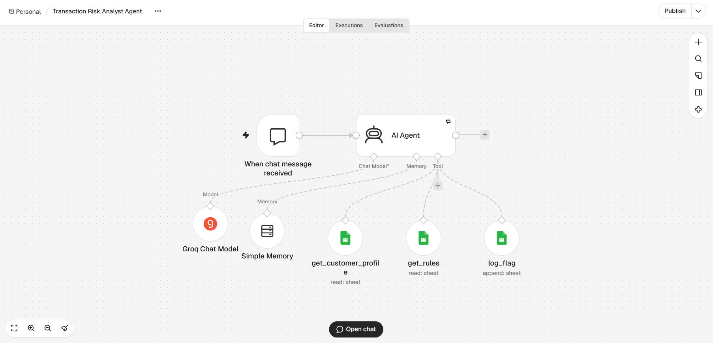
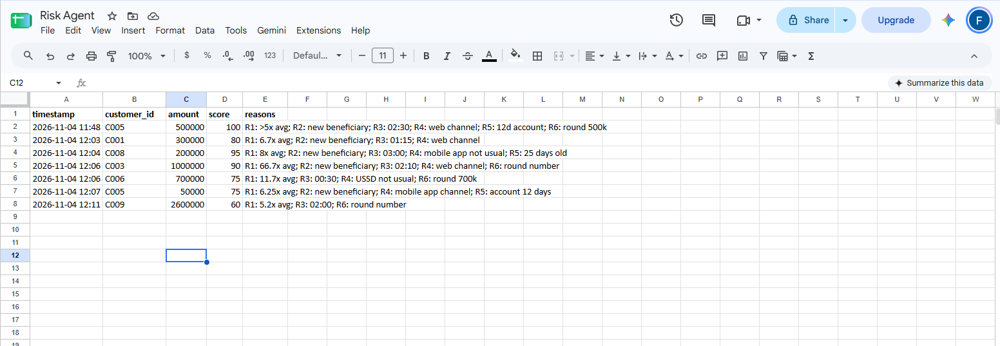

# Transaction Risk Analyst Agent (n8n + GPT-OSS-120B)

An AI agent that reviews a single bank transaction, compares it with the customer's normal behaviour and a set of weighted fraud rules, and returns a 0–100 risk score with a plain-English explanation. High-risk transactions (score ≥ 60) are logged automatically for analyst review.

The rule-based flagging comes from my earlier work at Access Bank, where I built SQL rules to flag suspicious transactions on high-risk accounts. This project tests what changes when an LLM agent applies the rules and explains its reasoning.



## How it works

| Part | What it does |
|---|---|
| **Chat Trigger** | Accepts a transaction: customer_id, amount (NGN), time, channel, new beneficiary (yes/no) |
| **AI Agent** | Plans the steps, calls the tools, scores the transaction and writes the explanation |
| **Groq Chat Model** | `openai/gpt-oss-120b` via Groq's free tier, temperature 0.1 |
| **Simple Memory** | Keeps context within one chat session |
| `get_customer_profile` | Google Sheets tool that looks up the customer's average amount, usual channels, usual hours and account age |
| `get_rules` | Google Sheets tool that reads the rules and their weights |
| `log_flag` | Google Sheets tool that appends a row to `Flagged`, but only when the score is ≥ 60 |

The rules live in a Google Sheet, so a risk analyst can change a rule or its weight without touching the workflow.

### Rules

| ID | Rule | Weight |
|---|---|---|
| R1 | Amount is more than 5× the customer's average | 30 |
| R2 | Beneficiary is new | 15 |
| R3 | Time is between 00:00 and 03:59 | 20 |
| R4 | Channel is not one of the customer's usual channels | 15 |
| R5 | Account is less than 30 days old | 15 |
| R6 | Round-number transfer (multiple of 100,000 and ≥ 500,000) | 10 |

Score = sum of the weights of the rules that fired, capped at 100.

### Example output

```json
{
  "customer_id": "C006",
  "score": 75,
  "triggered_rules": ["R1", "R3", "R4", "R6"],
  "explanation": "The transaction amount of 700,000 NGN is 11.7 times the customer's average of 60,000 NGN (R1). It occurs at 00:30 (R3) via USSD, which is not among the customer's usual mobile app channel (R4), and the amount is a round 700k (R6).",
  "logged": true
}
```

## Testing

I ran 15 test transactions: 5 clearly normal, 5 clearly suspicious and 5 boundary cases. I also ran 2 edge cases. Each test used a fresh chat session.

| Group | Tests | Result |
|---|---|---|
| Normal (expected 0) | 5 | 5/5 correct |
| Suspicious (expected 75–95) | 5 | 5/5 correct score, rules and logging |
| Boundary cases | 5 | 5/5 correct |
| Edge cases | 2 | 2/2 correct |

The boundary cases checked the exact edges of each rule:
- Amount **exactly** 5× the average, so R1 should not fire ✅
- Time **04:00**, so R3 should not fire ✅
- Channel typed as "Mobile App" in capitals, so R4 should still match ✅
- Score **55**, so the transaction should not be logged ✅
- Score **exactly 60**, so the transaction should be logged ✅

Edge cases:
- **Unknown customer:** the agent stopped after the profile lookup and did not score or log anything ✅
- **Missing fields:** the agent asked for the missing details without calling any tools ✅

The `Flagged` sheet ended up with exactly the 7 transactions that scored ≥ 60, and nothing below the threshold.



## Issues found and fixed

**1. The model called a tool that doesn't exist.**
The prompt said "reply with only this JSON". GPT-OSS sometimes read that as an instruction to call a tool named `json`, and Groq rejected the request.
*Fix:* I named the only three valid tools in the prompt and stated that the final answer is a text message, not a tool call. I also turned on Retry On Fail (3 tries) on the agent.

**2. Correct score, wrong reason.**
For R3, the explanations said the time was "outside usual hours" and sometimes quoted the customer's own hours (e.g. 07:00–22:00). R3 is actually a fixed night window for everyone. The score was right, but an analyst would have been given the wrong reason.
*Fix:* I added a clarification that R3 is a fixed night window and must not be explained using the customer's usual hours.
- Before: *"occurs at 03:59, which falls outside the usual operating hours of 07:00-22:00"*
- After: *"occurs at 03:59, which falls within the night window (00:00-04:00), triggering R3"*

**3. Unassessed transactions looked safe.**
An unknown customer returned `"score": 0`. A downstream system or a busy analyst could read 0 as "low risk", when it really meant "not checked".
*Fix:* Unassessed transactions now return `"score": null` and say they could not be assessed.

## Cost and speed

- About 5–9 seconds per transaction
- About 3,000–4,600 tokens and 3–4 model calls per full assessment
- About 900 tokens when the agent only needs to ask for missing details

## What I'd do next

- **Add R7: time outside the customer's usual hours.** Testing showed that no rule uses the `usual_hours` column.
- **Track beneficiary history** instead of relying on the user to say whether a beneficiary is new.
- **Make the output format more consistent**, e.g. always write currency as "NGN 160,000".
- **Run a larger labelled test set** using n8n Evaluations, so prompt changes can be checked automatically.
- **Add a human review step** in which an analyst approves or dismisses each flagged transaction, and use those decisions to tune the weights.

## Run it yourself

1. Run n8n locally with Docker:
   ```
   docker volume create n8n_data
   docker run -d --name n8n -p 5678:5678 -v n8n_data:/home/node/.n8n docker.n8n.io/n8nio/n8n
   ```
2. Create a free Groq API key at console.groq.com.
3. Create a Google Sheet with `Customers`, `Rules` and `Flagged` tabs (see `Risk Agent.xlsx`).
4. Import `workflow.json` into n8n, connect your Groq and Google Sheets credentials, and point the three tools at your sheet.

All customer data in this project is made up.
